# ☀️🚲 Pedal Power Station

**An off-grid bike that turns your own effort and sunshine into emergency power — and never plugs into the wall.**

Pedal Power Station is a product concept: a bicycle you can ride around the neighborhood *or* lock into a stand and pedal in place. Either way, every pedal stroke and every bit of sun goes into an onboard battery you can use to charge phones, run a Raspberry Pi, top up a 12 V car battery, or power a radio when the lights go out.

> **Status:** concept / design stage (v0.2). Not yet built or reviewed by an engineer — see [Safety](#safety).

<p align="center">
  <a href="docs/Pedal_Power_Station_Friendly_Guide.pdf">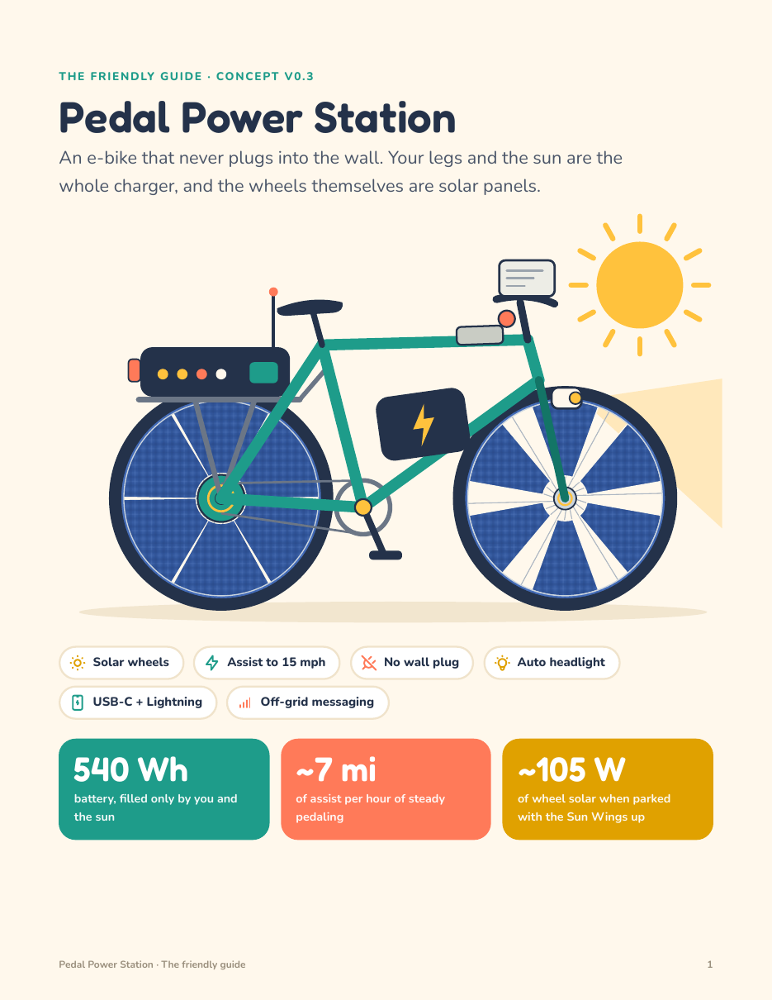</a>
  &nbsp;
  <a href="docs/Pedal_Power_Station_Spec_v0.2.pdf">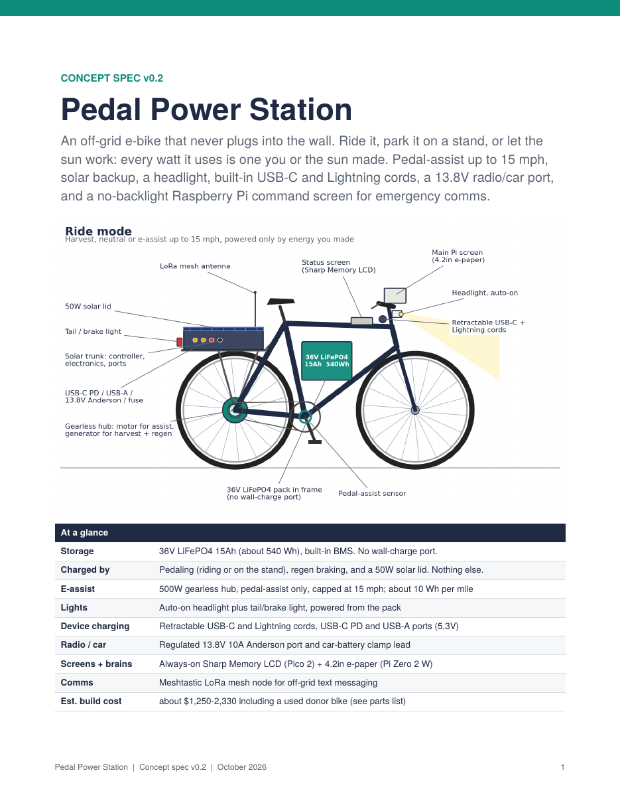</a>
</p>

📄 **[The Friendly Guide (PDF, 8 pages)](docs/Pedal_Power_Station_Friendly_Guide.pdf)**: the illustrated version, with Sun Wheels and Sun Wings

📐 **[Concept Spec v0.2 (PDF, 10 pages)](docs/Pedal_Power_Station_Spec_v0.2.pdf)**: the technical version, with the power system, Pi pin map, energy budget, parts list, build plan and safety notes

---

## The goals

- 🚴 **Two modes** — ride it, or pedal it stationary on a stand
- 🔋 **Charges a battery pack** from pedaling and built-in solar
- 🔌 **Never plugs into the house** — the only energy in it is energy *you* made (pedal, sun, regen braking)
- ⚡ **E-bike assist**, capped at **15 mph** (Michigan Class 1 territory)
- 🖥️ **Powers a Raspberry Pi** with a no-backlight, ultra-low-power screen
- 📱 **Emergency outputs** — 5.3 V USB, 13.8 V DC (car battery / ham radio), plus built-in **USB-C and Lightning** cords
- 💡 **Auto-on headlight** for pedaling after dark
- ☀️ **Solar in the wheels** — "Sun Wheels" and lift-up "Sun Wings"

---

## How it works

```
  Pedaling ──► Rear hub motor (generator / assist) ──┐
                                                     ├──► Regen-capable motor controller ──► 36 V LiFePO4 pack (~540 Wh)
  Sun Wheels + Sun Wings ──► Solar charge controller ┘                                         │
                                                                                               ├──► E-bike assist (≤15 mph)
                                                                                               ├──► 13.8 V DC out (car battery, radios)
                                                                                               ├──► 5.3 V USB / USB-C / Lightning
                                                                                               ├──► Headlight (auto-on)
                                                                                               └──► Pi Zero 2 W + screens
```

- **Rear hub motor** does double duty: it's the generator when you pedal and the motor when you want assist.
- **Battery:** 36 V LiFePO4, about 540 Wh. A **25 % reserve** is held back for emergencies — assist cuts out before you eat into it.
- **No wall port.** Charging only comes from pedaling, the sun, and regenerative braking.

## Sun Wheels & Sun Wings

- **Sun Wheels** — solar cells on both faces of the wheels plus strips on the rims. The rear wheel is a full disc; the front uses a six-petal design to cut down on wind resistance. Because a wheel spins flat in its own plane, the cells keep a steady angle to the sun while you ride.
- **Sun Wings** — panels on each side of the front wheel that slide up through a slit and tilt on swing arms to face the sun when parked. A safety sensor won't let you ride until they're locked back down.

## Screens

| Screen | Where | What it shows |
|---|---|---|
| 2.7" Sharp Memory LCD (no backlight), driven by a Raspberry Pi Pico | Top tube | Time, pedal watts, battery %, time to full, solar watts, which outputs are on. Always on, even when the Pi sleeps. The Pico also reads sensors, sets pedal resistance and switches outputs. |
| 4.2" e-paper, driven by a Pi Zero 2 W | Handlebars | Four tabs: off-grid mesh messages, energy history, map, settings. Wakes only when needed. |

## What to expect (rough estimates)

| Source | Energy |
|---|---|
| Steady pedaling, 1 hour | ~72 Wh (about 5 phone charges) |
| Parked with Sun Wings up | ~105 W peak |
| Clear Michigan summer day (solar) | ~250 Wh — roughly 25 miles of assist |
| Winter | much less |

## Rough cost

About **$1,500–2,750** for a one-off build with Sun Wheels and Sun Wings, including a used starter bike. The v0.2 spec, which has a 50 W solar lid in place of the wheel panels, comes to about $1,250–2,330. Prices were checked in October 2026 and will move.

## Software

All the code for the bike is in [`software/`](software). The **Pico 2 firmware** runs the always-on status screen and enforces the 15 mph cap, the 25 % reserve, the brakes and the Sun Wings lock. It also sets assist and pedal resistance and switches the outputs. The **Pi Zero 2 W app** runs the e-paper screen (Mesh, Energy, Map and Setup tabs), keeps the energy history and handles LoRa mesh messages. There's also a PC simulator and 39 tests. See the **[software guide](software/README.md)** to install it and for what to check before riding.

| Status screen, on the stand | Status screen, riding | Pi screen, mesh messages |
|---|---|---|
| 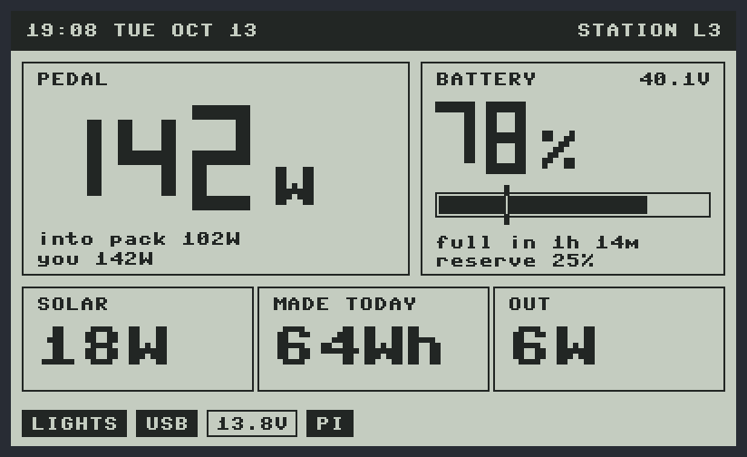 | 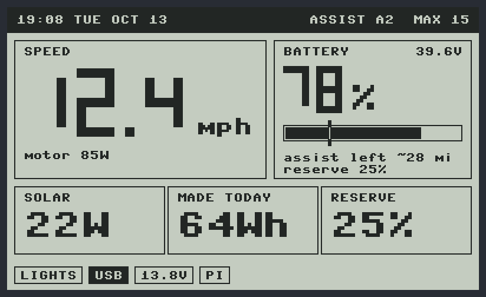 | 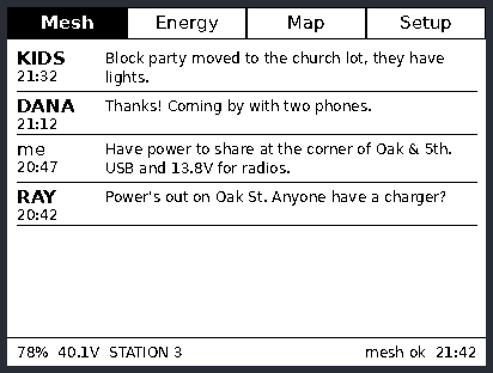 |

## The documents

### The Friendly Guide
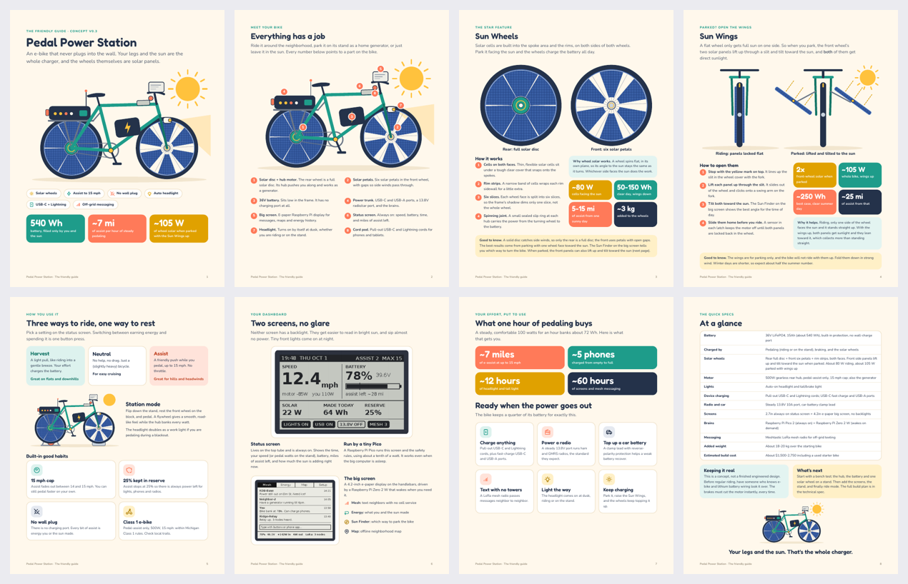

### Concept Spec v0.2
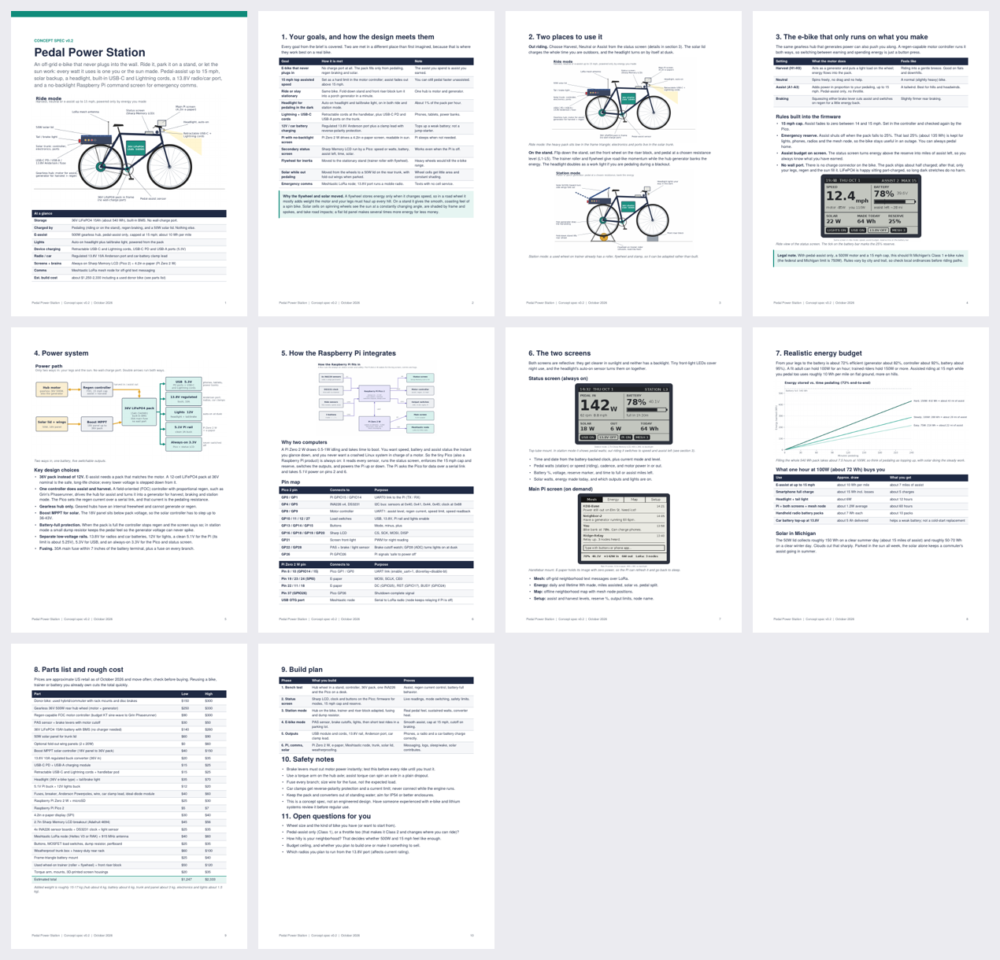

### Drawings

| Ride mode | Station mode |
|---|---|
| 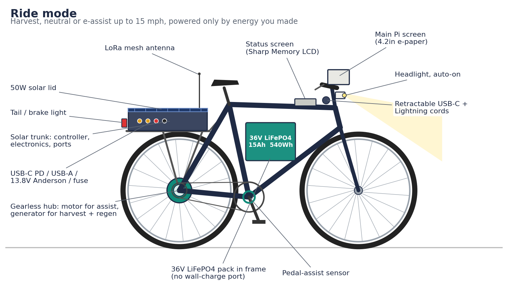 | 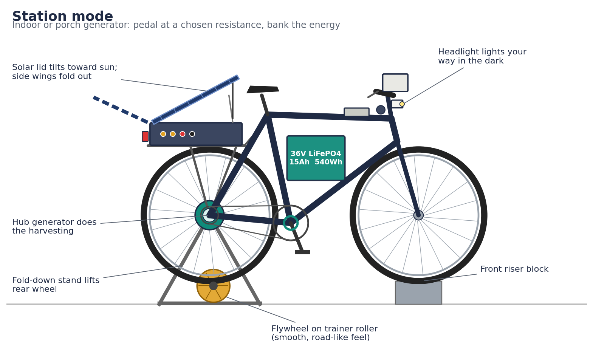 |
| **Power path** | **Raspberry Pi integration** |
| 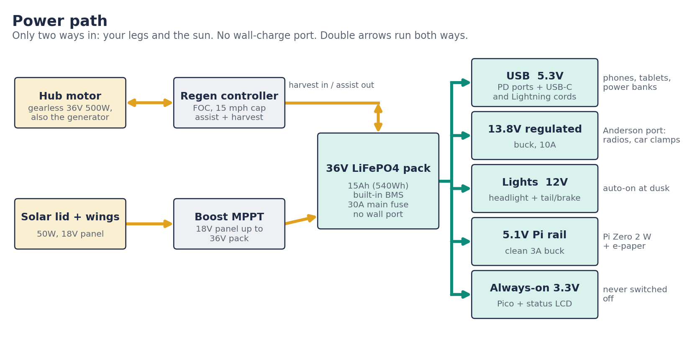 | 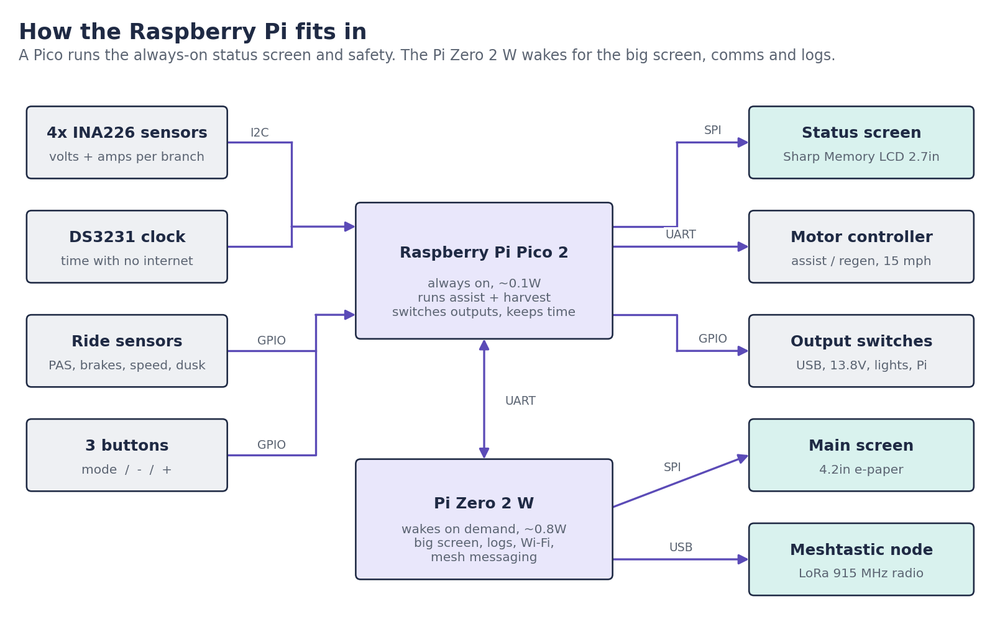 |
| **Status screen** | **Status screen (riding)** |
| 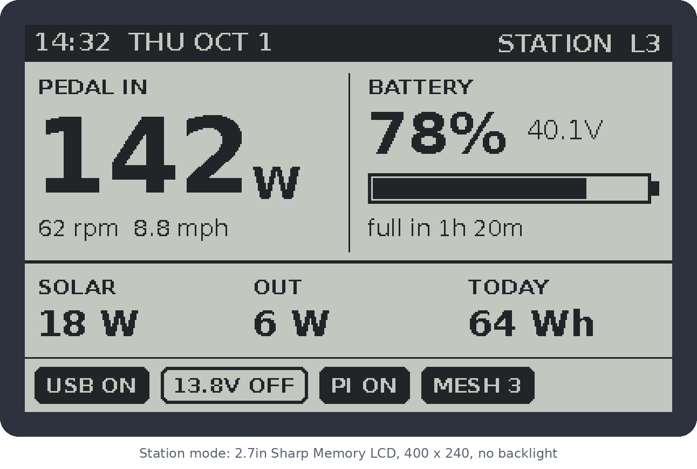 | 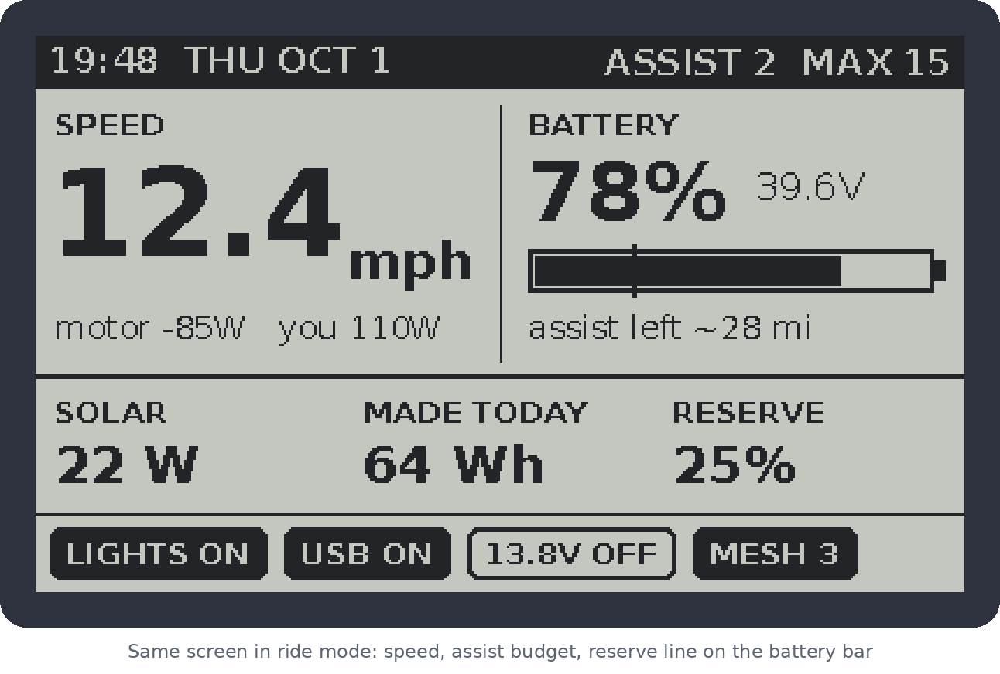 |
| **Main Pi screen** | **Energy budget** |
| 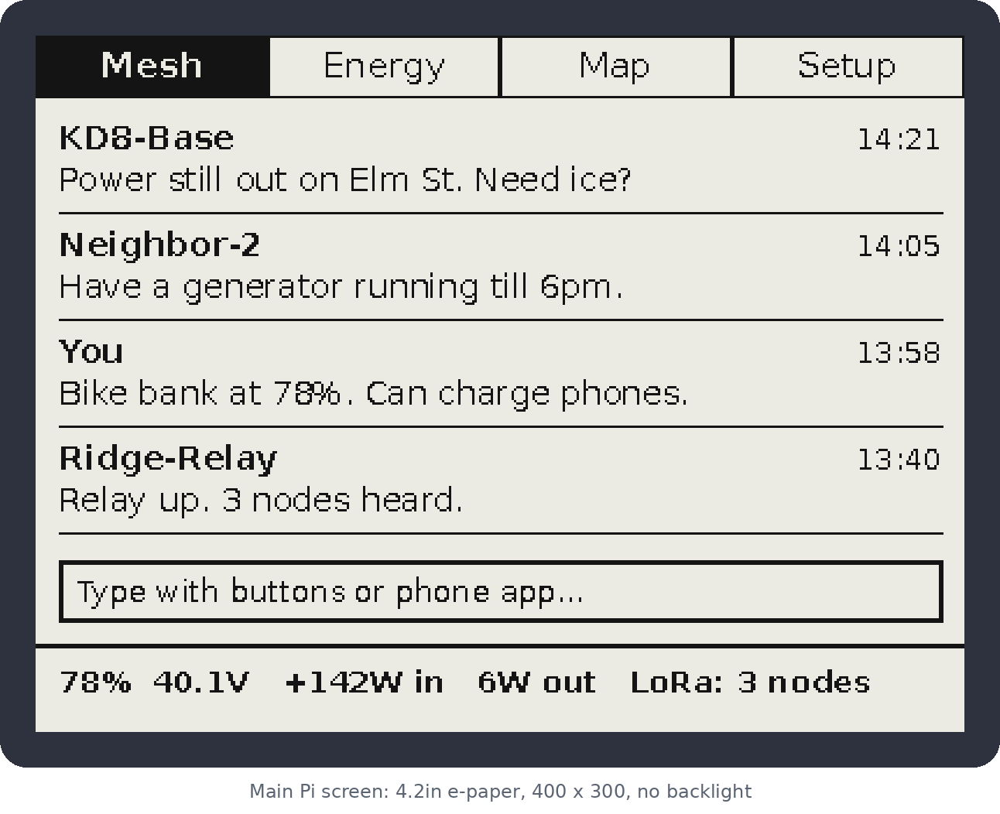 | 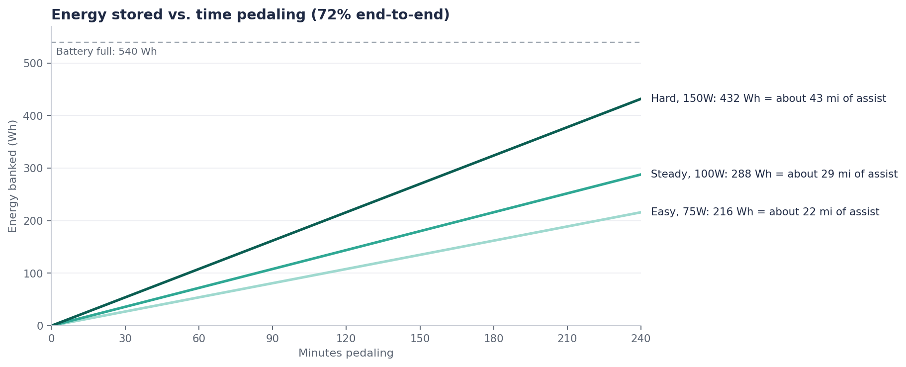 |

## Open questions

1. Bike and wheel size
2. How much riding vs. stationary use
3. Final pedal-assist settings
4. Budget — build one, or make it a product to sell?
5. Which radios to run off the 13.8 V output

## Safety

This is a concept. The drawings are concept art, not engineering renders, and the electrical design hasn't been reviewed. Have someone who knows 36 V / 12 V lithium systems check the wiring, fusing and BMS before relying on it.

---

*Part of the things I'm making :) — see also [PiMesh](https://github.com/hardwaremack-prog/PiMesh) and [Ham Radio Museum](https://github.com/hardwaremack-prog/ham-radio-museum).*
