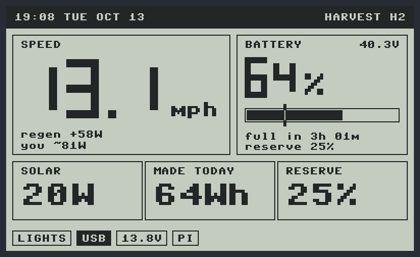
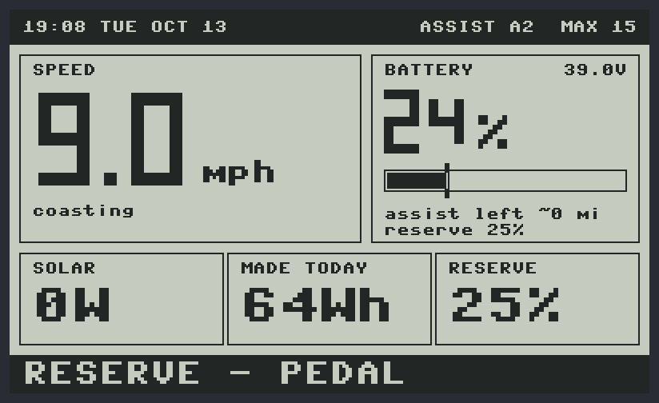
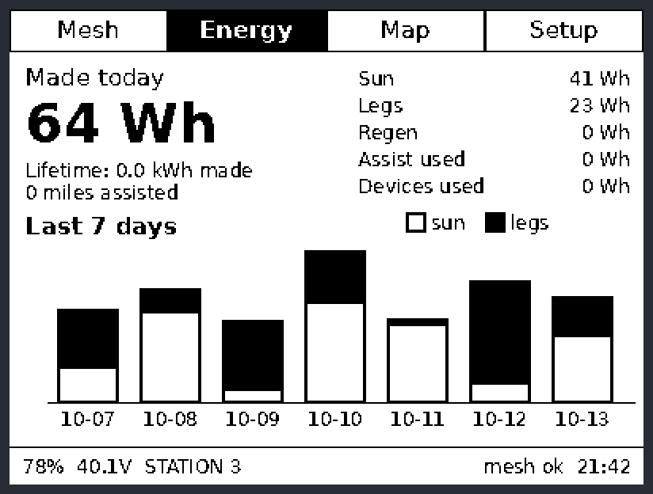
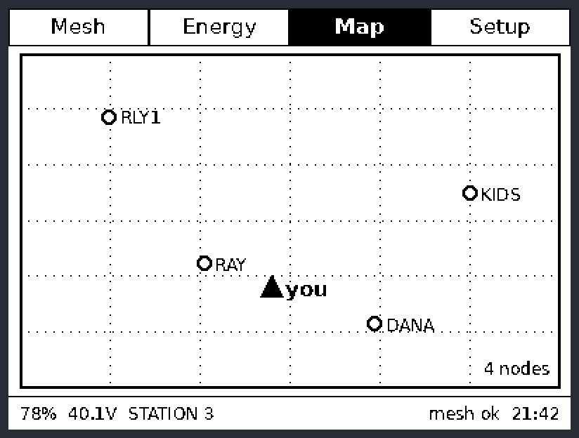
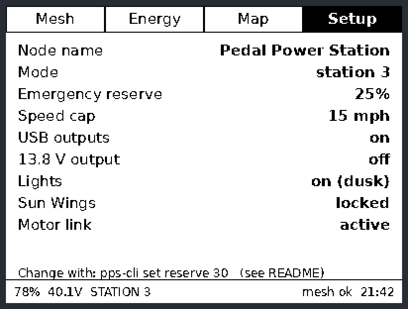

# Pedal Power Station: software

The bike runs on two small computers, the same split described in the [concept spec](../docs/Pedal_Power_Station_Spec_v0.2.pdf) (section 5):

| | Runs on | Job |
|---|---|---|
| [`pico/`](pico) | **Raspberry Pi Pico 2**, always on (MicroPython) | Reads every sensor, runs the status screen, enforces the 15 mph cap and 25 % reserve, sets assist and pedal resistance, switches the outputs and lights, and powers the Pi up and down |
| [`pi/`](pi) | **Raspberry Pi Zero 2 W**, on demand (Python 3) | Handlebar e-paper screen with Mesh, Energy, Map and Setup tabs, energy history, LoRa mesh messages, and the `pps-cli` tool |
| [`sim/`](sim) | Any PC | Runs the real code with pretend sensors and saves pictures of both screens |
| [`tests/`](tests) | Any PC | 39 tests covering the safety rules, battery math, buttons, Pi power-down, sensor scaling and the Pi app |

A crashed Linux system should never be in charge of a motor, so the Pico does all the safety-critical work and the Pi only displays and logs.

> ⚠️ **Not road-tested.** This code has only run in the simulator and tests, never on a real bike. Bench-test everything with the wheel off the ground before you ride, and see [Before you ride](#before-you-ride).

---

## The status screen (Pico, 2.7" Sharp Memory LCD, no backlight)

These pictures were drawn by the real `ui.py` through the simulator:

| On the stand | Riding with assist |
|---|---|
|  |  |
| **Harvest (charging while riding)** | **Below the 25 % reserve** |
|  |  |

## The big screen (Pi Zero 2 W, 4.2" e-paper)

| Mesh | Energy |
|---|---|
|  |  |
| **Map** | **Setup** |
|  |  |

---

## Buttons

| Button | Short press | Hold (about 1 s) |
|---|---|---|
| **MODE** | Harvest → Neutral → Assist | Station mode on/off |
| **−** | Level down | Put the Pi to sleep (clean shutdown) |
| **+** | Level up | Wake the Pi screen, or go to the next tab |

Levels are **H1–H3** in Harvest, **A1–A3** in Assist and **L1–L5** on the stand.

## What the Pico enforces

- **15 mph cap.** Assist fades from full at 14 mph to zero at 15. The controller is set to the same limit, and the Pico checks it again on top of that. The Pi can lower the cap but can never raise it above 15.
- **Emergency reserve.** Assist stops at 25 % battery (adjustable from 10 to 50 %). The rest is kept for lights, phones, radios and the mesh node.
- **Brakes.** Squeezing either brake lever cuts assist immediately and switches on regen, unless the pack is already full.
- **Sun Wings.** If the wings aren't latched down, there's no assist and the screen says **LOCK WINGS**. The firmware can't physically stop you riding, so the latch itself needs to be solid.
- **Full pack.** When the pack is full, Harvest stops regen. On the stand, a dump resistor takes the load so the pedals still feel the same.
- **Flat battery.** USB, 13.8 V and the Pi switch off below 3 % to protect the pack, and come back on at 6 %.
- **Dusk.** A light sensor switches the head and tail lights and the screen's front-light on at dusk and off again at dawn.
- **Crashes.** If the main loop throws an error, assist and regen are zeroed first. A hardware watchdog resets the Pico if the loop ever stops.

## Before you ride

1. **Fill in the motor controller registers.** The Modbus register numbers in [`pico/config.py`](pico/config.py) (`MOTOR_REG`) are left blank on purpose, because they differ between controllers and firmware versions. Until you fill them in from your controller's documentation (for a Phaserunner, Grin's register list or Phaserunner Suite) and set `MOTOR_REGISTERS_VERIFIED = True`, the firmware runs in **safe mode**: it reads only and never sends assist or regen. The screen shows **MOTOR SAFE** while it's in this mode. Also check that your controller uses the same scaling the code sends (amps × 10, mph × 10).
2. **Set the controller's own limits** in its own software as well: the 15 mph cap, a battery current limit and a regen limit. The Pico is the second line of defense, not the first.
3. **Check the sensor chips.** The spec names the INA226, but its bus pin only reads up to 36 V and this pack reaches 43.8 V. So the pack-side sensors default to the **INA228** (85 V). Edit `SENSORS` in `config.py` if you fit something else.
4. **Two pins were added after spec v0.2:** GP2 for the Sun Wings latch switch and GP3 for the dump-load MOSFET.
5. **Bench-test with the wheel off the ground.** Try every mode, the brakes, the wings switch and the speed cap before you ride.

## Install: Pico

1. Flash MicroPython onto a Pico 2 (micropython.org → Raspberry Pi Pico 2 → drag the `.uf2` file onto it).
2. Copy the firmware over:
   ```bash
   pip install mpremote
   cd software/pico
   mpremote cp *.py :
   mpremote reset
   ```
3. Set the clock once from a computer: `mpremote exec "import ds3231, machine; ds3231.DS3231(machine.I2C(0, sda=machine.Pin(4), scl=machine.Pin(5))).set(2026, 10, 13, 21, 40, 0, 2)"`. After that, `pps-cli time` copies the Pi's clock over whenever the Pi has internet.

## Install: Pi Zero 2 W

On a fresh Raspberry Pi OS Lite (Bookworm or newer):

```bash
git clone https://github.com/hardwaremack-prog/pedal-power-station
cd pedal-power-station/software/pi
sudo ./install.sh
sudo reboot
```

The install script sets up the UART link to the Pico, SPI for the e-paper, and the power-off signal on GPIO26. It also installs the app, Waveshare's e-paper driver and Meshtastic, and starts everything at boot. Settings are in `/etc/pps/config.toml`, where you can set the node name, a mesh "power to share" beacon, the idle sleep time and an offline map image.

### pps-cli

```
pps-cli status                 battery, mode, power in/out
pps-cli set reserve 30         emergency reserve % (10-50)
pps-cli set speed_cap 12       lower the assist cap (5-15 mph)
pps-cli set usb 0|1            USB outputs off/on
pps-cli set out_13v8 0|1       13.8 V output off/on
pps-cli send "Have power to share at Oak & 5th"
pps-cli tab 2                  show a tab (0 Mesh, 1 Energy, 2 Map, 3 Setup)
pps-cli time                   copy the Pi's clock to the bike's clock
pps-cli sleep                  shut the Pi down now
```

## Try it on a PC

```bash
pip install pillow pytest
python3 software/sim/simulate.py     # pictures of both screens -> software/sim/out/
python3 -m pytest software/tests     # 39 tests
```

## How the pieces talk

```
                 I2C: 4x INA228 + DS3231 clock
                         │
  buttons, brakes, ──► PICO 2 ──UART1 Modbus──► motor controller ──► gearless hub
  wings, light sensor    │  │
                         │  └─ load switches: USB · 13.8 V · Pi rail · lights · dump load
                 SPI ────┘  │
         Sharp status LCD   └─UART0 JSON lines──► PI ZERO 2 W ──SPI──► 4.2" e-paper
                              ◄── GPIO26 "halted"      │
                                                       └─USB──► Meshtastic LoRa node
```

| File | What it does |
|---|---|
| `pico/main.py` | The 100 ms loop that ties everything together |
| `pico/rules.py` | Speed cap, reserve, brakes, wings, full pack, outputs, lights |
| `pico/energy.py` | Battery % (coulomb counting with re-sync at full), Wh counters, assist miles left |
| `pico/ui.py`, `draw.py` | Status screen layouts and chunky seven-segment digits |
| `pico/sharp_lcd.py` | Sharp Memory LCD driver (including the once-a-second VCOM flip it needs) |
| `pico/ina2xx.py`, `ds3231.py` | Power sensors and the clock |
| `pico/motor.py` | Modbus RTU link to the controller, with safe mode |
| `pico/pipower.py` | Powers the Pi down only after Linux has fully shut down |
| `pico/buttons.py`, `link.py`, `store.py` | Buttons, the Pi link, saving to flash |
| `pi/pps/app.py` | Pi main loop, idle sleep, mesh beacon, control socket |
| `pi/pps/screens.py` | The four e-paper tabs |
| `pi/pps/mesh.py` | Meshtastic messages and node positions |
| `pi/pps/energylog.py` | Daily history in SQLite |
